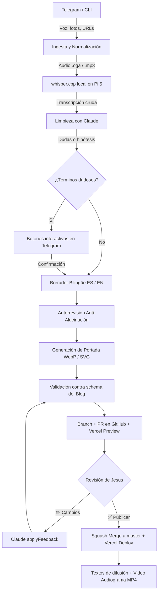

# Talking With Myself (`twm`)

> Agente autónomo para convertir notas de voz, fotos y enlaces en artículos bilingües (español e inglés), publicarlos en [cabrera.systems/blog](https://cabrera.systems/blog) mediante Pull Requests y desplegarlos en producción sin costo de APIs.

Corre 24/7 en una **Raspberry Pi 5** como servicio `systemd` administrado a través de un bot de Telegram con *long polling*.

---

## 🌟 Características clave

- **Costo $0 en inferencia**: Usa Claude Code (`claude -p`) a través de la suscripción existente de Claude mediante token OAuth persistente, sin consumir APIs de pago.
- **Transcripción local en la Pi**: `whisper.cpp` con el modelo `ggml-large-v3-turbo-q5_0` corriendo directamente en el procesador ARM Cortex-A76 de la Pi 5.
- **Estricta política anti-alucinación**: Un revisor independiente compara el borrador final contra la transcripción cruda y elimina cualquier hecho, cifra o métrica inventada.
- **Redacción bilingüe nativa**: Redacta el post en el idioma de la nota de voz y genera una adaptación natural (no traducción literal) al otro idioma (ES ↔ EN).
- **Publicación automática con control humano**:
  1. Abre una rama y un Pull Request en el repositorio [`cabrera-systems-blog`](https://github.com/JesusCabreraReveles/cabrera-systems-blog).
  2. Genera un preview automático en Vercel.
  3. Al confirmar desde Telegram o CLI, ejecuta un *squash merge* a la rama `master` y actualiza la fecha de publicación al día exacto.
- **Difusión multicanal automática (Stage 5)**:
  - **LinkedIn (ES/EN)**: Hook contundente, 2-3 párrafos y hashtags profesionales.
  - **X / Twitter (ES/EN)**: Copies optimizados para cuentas estándar (≤ 280 caracteres con URL canónica).
  - **Dev.to / Hashnode**: Archivos Markdown listos para importar con `canonical_url` y assets apuntando a GitHub.
  - **Audiograma en video MP4 (1080x1080)**: Generado con `ffmpeg` con onda de audio animada en naranja (`#f97316`) acotado a ≤ 140s para el feed de X.

---

## 🏗 Arquitectura del Pipeline



---

## 🤖 Interfaz de Telegram (@Talkingwithnyself_bot)

El bot opera por *long polling* con whitelist estricta (`TELEGRAM_ALLOWED_CHAT_ID`), por lo que la Pi no requiere puertos abiertos ni IP pública.

### Comandos disponibles

| Comando | Descripción |
|---|---|
| `/nuevo` | Abre un nuevo post y entra en modo de recopilación de notas, audios y fotos. |
| `/listo` | Cierra la recopilación e inicia el pipeline (transcripción, borrador y preview). |
| `/estado` | Muestra el progreso del post activo o su enlace de preview. |
| `/cancelar` | Descarta el post en curso y limpia la sesión. |
| `/reintentar` | Reanuda el procesamiento si Claude se pausó o hubo un corte temporal. |
| `/share` | Muestra los copies listos para copiar y pegar para LinkedIn, X y Dev.to. |
| `/audiograma` | Renderiza y envía el video MP4 (≤ 140s) para adjuntar en X / Twitter. |
| `/deshacer` | Elimina el último elemento enviado (última foto, URL o audio). |
| `/quitar` | Muestra un teclado interactivo para seleccionar qué elemento eliminar. |
| `/unpublish <id>` | Abre un PR para despublicar un post (`draft: true`). |

### Patrones para imágenes
- Al enviar fotos en Telegram, incluye en el pie de foto:
  - `#portada`: fuerza la foto como portada del artículo.
  - `#1`, `#2`, `#n`: fija la posición de la imagen en el cuerpo del texto.
  - Si no envías foto, el agente te pregunta si prefieres que genere una portada geométrica con la paleta de la marca.

---

## 💻 Interfaz de Línea de Comandos (CLI)

```bash
# Crear borrador a partir de una carpeta local
twm draft <carpeta-con-audio-e-imagenes> [--audio] [--yes]

# Ver el estado de un job
twm status <job-key-o-postId>

# Abrir PR y generar preview de Vercel (o confirmar squash merge con --confirm)
twm publish <job-key> [--confirm]

# Generar y mostrar textos de difusión para redes
twm share <job-key-o-postId>

# Despublicar un post en producción
twm unpublish <postId> [--confirm]

# Ejecutar limpieza de jobs antiguos y temporales
twm cleanup [--days=180] [--dry-run]

# Generar variantes de portada de prueba
twm covers "Título del Post"
```

---

## 🍓 Despliegue en la Raspberry Pi 5

El agente corre como servicio de fondo administrado por `systemd`.

### 1. Despliegue automatizado desde la Mac
Para actualizar el código, dependencias o servicios en la Pi:
```bash
./deploy/deploy-pi.sh
```

### 2. Servicios `systemd` configurados
- **`twm.service`**: Bot de Telegram y orquestador activo 24/7.
  - Prioridad controlada: `Nice=10`, `CPUQuota=300%` y `MemoryMax=3G` para coexistir con otros proyectos de la Pi.
  - Reinicio automático ante fallos: `Restart=always`, `RestartSec=5`.
- **`twm-cleanup.timer`**: Mantenimiento semestral (1 de enero y 1 de julio a las 03:00) que ejecuta `twm cleanup --days=180` para limpiar temporales y trabajos antiguos en la SD.

### 3. Monitoreo de logs en la Pi
```bash
# Ver logs en vivo del agente
ssh chch@raspberrypi.local "sudo journalctl -u twm.service -f"

# Ver estado del timer de limpieza semestral
ssh chch@raspberrypi.local "sudo systemctl list-timers twm-cleanup.timer"
```

---

## ⚙️ Configuración y Secretos

- **`config.yaml`**: Parámetros de configuración no sensibles (rutas, autor de git, modelo de Whisper, paleta de colores).
- **`/etc/twm/agent.env`** (en la Pi) o **`.env`** (local):
  ```ini
  TELEGRAM_BOT_TOKEN="<bot_token>"
  TELEGRAM_ALLOWED_CHAT_ID="<tu_id_numerico_de_telegram>"
  GITHUB_TOKEN="<personal_access_token_con_repo_scope>"
  CLAUDE_CODE_OAUTH_TOKEN="<token_1_año_generado_con_claude_setup-token>"
  GIT_AUTHOR_NAME="Jesus Cabrera"
  GIT_AUTHOR_EMAIL="jcr1984@gmail.com"
  GIT_COMMITTER_NAME="Jesus Cabrera"
  GIT_COMMITTER_EMAIL="jcr1984@gmail.com"
  ```

---

## 🧪 Pruebas automatizadas

El proyecto incluye una suite de pruebas unitarias que no consumen llamadas externas a Claude:
```bash
# Ejecutar suite de pruebas
npm test

# Verificación de tipos TypeScript
npm run check
```

---

## 👤 Autor

**Jesus Cabrera** ([@JesusCabreraReveles](https://github.com/JesusCabreraReveles))  
Blog: [cabrera.systems/blog](https://cabrera.systems/blog)  
X: [@TalkingWMy](https://twitter.com/TalkingWMy)  

*Desarrollado en pareja con Claude Code.*
